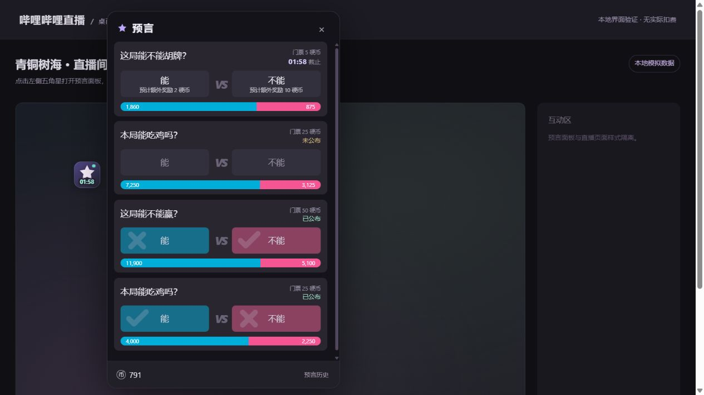
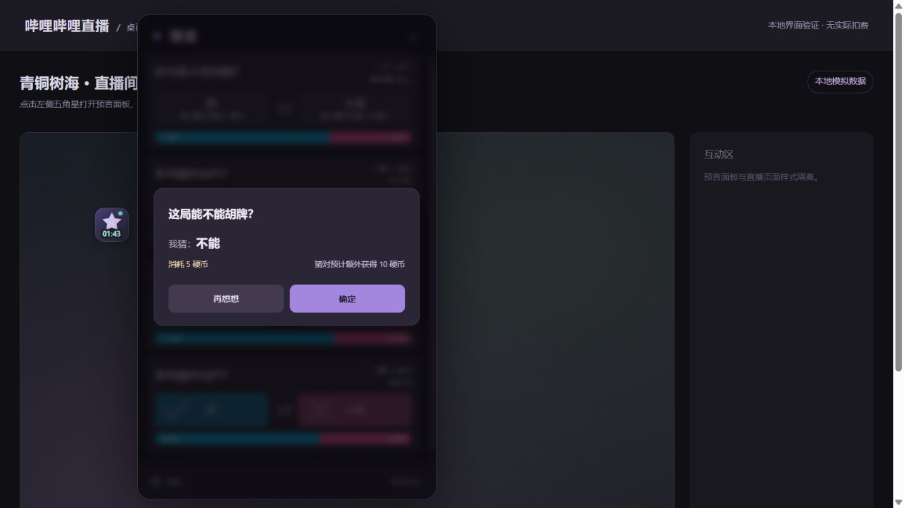
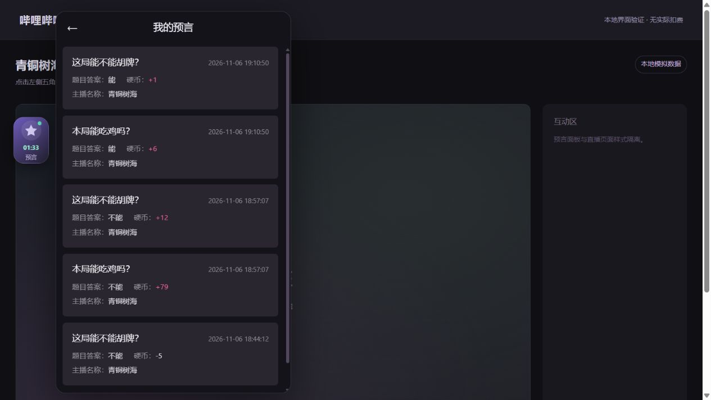
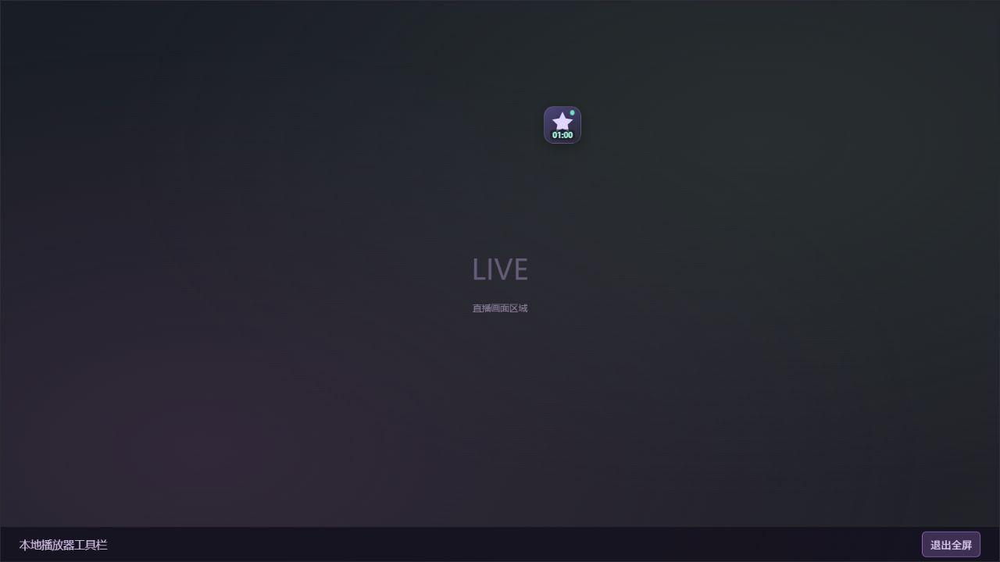

# biliBetWeb

在哔哩哔哩电脑直播间查看和参与手机端预言的 Tampermonkey / Violentmonkey 用户脚本。

**当前版本：1.0.6**

[安装 / 更新脚本](https://raw.githubusercontent.com/jiazaiwanbi/biliBetWeb/main/bilibili-live-prophecy.user.js) · [示例直播间](https://live.bilibili.com/1774678)

## 安装

1. 在 Chrome / Edge 中启用 Tampermonkey（油猴）。
2. 点击上方 **安装 / 更新脚本**，按脚本管理器提示安装；也可以打开仓库内的 `bilibili-live-prophecy.user.js`，复制全部内容手动安装。
3. 点击油猴图标 → **添加新脚本**，删除编辑器中的默认内容，粘贴脚本并按 **Ctrl+S** 保存。
4. 打开或刷新 <https://live.bilibili.com/1774678>，左侧会出现紫色五角星。
5. 点击五角星打开面板。按住并拖动五角星可以调整位置；普通模式和全屏模式的位置分别自动保存，切换后恢复各自的位置。

脚本也支持其他采用同一预言功能的数字直播间地址；自动识别房间号和主播 UID。

## 功能

- 接近手机端的紧凑深色卡片、蓝粉色投入进度条和选项按钮。进行中卡片右上角仅保留门票、倒计时两行；移除重复的参与状态、底部说明和创建时间，缩矮选项按钮。
- 入口为 48×48 的半透明方形图标，不再单列“预言”文字；倒计时轻叠在五角星下缘。五角星和卡片都显示正在进行的预言倒计时；多条同时进行时，图标显示最近的截止时间。
- 支持播放器原生全屏和网页全屏。全屏时图标跟随底部控制栏显隐；打开预言面板、鼠标停在图标上或拖动时保持可见。
- 参与截止后显示 **未公布**；结算后显示 **已公布**、正确答案和参与结果；同时区分 **未开始 / 已取消 / 暂无预言**。
- 显示硬币余额、参与门票、预计额外奖励、自己的选择。
- 支持参与预言。选择选项后以一行显示消耗硬币数与猜对预计额外奖励，点击 **确定** 才会提交。
- 已公布的 A/B 选项分别使用蓝色、粉色底色，正确答案显示大号对勾，错误答案显示大号叉号。
- 点击底部“预言历史”，在主面板上方覆盖显示手机端“我的预言”页面：题目、完整公布时间、题目答案、实际硬币变化和主播名称，正收益为粉色。左上角 **←** 返回主功能页面，并保留主列表的滚动位置；历史覆盖服务端本次返回的记录范围。
- 使用服务端时间校准倒计时；界面打开且有进行中的预言时约每 4 秒刷新，关闭后降低刷新频率。
- 不内嵌账户信息，不需要填写 Cookie；自动使用当前浏览器的哔哩哔哩登录状态。

## 如何参与

1. 先在同一个浏览器登录哔哩哔哩。
2. 打开预言面板，选择仍在倒计时的题目。
3. 选择答案，核对题目、门票和预计奖励，再点 **确定**。

提交前会再次检查登录账号、预言状态、已选答案和余额。同一题成功参与后会锁定选项；超时或提交结果不明确时不会自动重发。遇到这种情况，先核对参与记录再刷新页面。

## 更新到 1.0.6

已有脚本时，在油猴编辑器中用新版文件替换全部内容，按 **Ctrl+S**，然后刷新直播间。

历史页使用服务端公布时间，按当前浏览器时区显示年月日和时分秒；“题目答案”是主播公布的正确答案，“硬币”是服务端实际结算变化。每次进入历史页会重新读取，缺失的结算数据显示 `—`。

主界面已移除上方切换标签、问号、刷新按钮、账号信息行和参与规则说明；底部只保留硬币余额和“预言历史”。后台继续自动更新预言和倒计时，无需手动刷新按钮。

普通模式与全屏模式分别记录位置；旧版本保存的位置作为普通模式的初始位置。全屏图标读取播放器控制栏的真实显隐状态；播放器结构变化而暂时找不到控制栏时，以约 3 秒无操作隐藏作为备用处理。

## 常见问题

**没有出现五角星**

- 确认脚本已启用，当前网址为 `https://live.bilibili.com/数字房间号`。
- 检查浏览器是否允许油猴运行用户脚本。按油猴自身提示开启“允许用户脚本”或对应的开发者选项后，刷新直播间。
- 若位置异常，可从油猴菜单选择 **重置当前模式图标位置**，只重置当前显示模式。

**提示未登录，或接口访问失败**

- 在同一浏览器登录后，刷新直播间网页。网络短暂异常时，脚本也会自动重试读取。
- 如果油猴询问是否允许访问接口，允许脚本访问 `api.live.bilibili.com` 和 `api.bilibili.com`。
- 本脚本不需要 mitmproxy、模拟器或 CA 证书。

**看不到正在进行的预言**

主播可能尚未开启、已截止或已公布。脚本按服务端数据展示，不会把已截止题目当作可参与题目。

## 验证范围

2026-11-08：已核对手机页面的接口和状态枚举，并用真实接口验证房间识别、时间同步、预言列表及个人历史。已在本地模拟环境验证面板、倒计时、状态、历史、确认/取消、参与成功和提交超时；10 项逻辑测试通过，包含历史正确答案、实际硬币变化、公布时间和全屏模式识别检查。

1.0.4：已在当前直播页面只读核对控制栏结构，并在本地模拟播放器验证两套拖动位置、刷新后恢复、网页全屏控制栏显隐同步和打开面板时保持可见。内置浏览器拒绝原生全屏请求，因此原生全屏尚未完成浏览器实测。

参与提交依照手机页面的表单格式实现，包含 `csrf` 和 `csrf_token`。没有为测试提交真实参与或消耗实际硬币，因此实际扣费流程仍需由你在正常参与时确认。

接口来源于当前手机页面，平台后续更改接口时可能需要更新脚本。


## 效果预览

### 主面板



### 确认参与



### 我的预言



### 全屏显示 / 隐藏




## 开发与检查

脚本为单文件实现，无运行时依赖。使用 Node.js 22 或更新版本执行：

```sh
npm run check
npm test
```

`test/prophecy.test.cjs` 覆盖截止时间、状态、参与条件、奖励计算、排序、HTML 转义、历史数据取值与全屏识别。测试不连接真实接口，不提交真实参与。

发布更新时，修改脚本头部的 `@version` 并推送到 `main`，脚本管理器可通过 GitHub 上的 `@updateURL` / `@downloadURL` 检查新版。

## 许可

[MIT](LICENSE)
